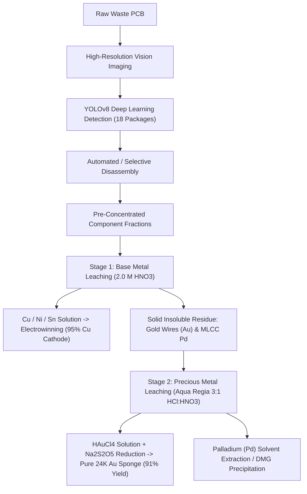

# ⚗️ Machine Vision-Assisted E-Waste Characterization & Real-Time Metallurgical Valuation Platform

[](https://pcb-metallurgy-valuation-vqpsze4n8aq79bldnr5poe.streamlit.app/)
[](https://www.python.org/)
[](https://ultralytics.com)
[-Metallurgical%20Engineering-800000.svg)](https://iitbhu.ac.in)
[](https://github.com/HarmanBhangu1313/pcb-metallurgy-valuation)

> **Department of Metallurgical Engineering, Indian Institute of Technology (Banaras Hindu University), Varanasi**  
> **Course:** MT-392 : Undergraduate Project / B.Tech Thesis  
> **Authors:** Sourav Kumar Agarwal (23145088), Rituraj Singh (23145065), Harman Singh Bhangu (23145034)  
> **Supervisor:** Dr. Kamalesh Kumar Singh | **Mentor:** Mr. Sayantan Mukherjee  

---

## 🌐 Live Interactive Web App

🚀 **Experience the Live Platform:**  
👉 **[https://pcb-metallurgy-valuation-vqpsze4n8aq79bldnr5poe.streamlit.app/](https://pcb-metallurgy-valuation-vqpsze4n8aq79bldnr5poe.streamlit.app/)**

*Deploying YOLOv8 object detection, live commodity futures feeds (Au, Ag, Pd, Cu, Al, Ni, Sn), and full hydrometallurgical mass balance calculations in Indian Rupees (₹).*

---

## 📌 Project Overview

Rapid miniaturization and shrinking lifecycles of modern consumer electronics have generated over **62 million metric tonnes of annual e-waste globally**. Waste printed circuit boards (WPCBs) represent exceptionally high-grade secondary urban ores containing up to **200–500 g/t Gold** and **15–25% Copper**. However, conventional recycling relies on brute-force shredding or hazard-prone informal smelting, leading to:
- **30–40% loss of precious metals** (Au, Pd) during physical separation.
- **Massive chemical wastage**: Consumes over **650 mL of concentrated nitric acid per board**.
- **Toxic emissions**: Release of polybrominated dibenzo-p-dioxins and furans during thermal pyrolysis.

This project introduces an **integrated machine vision and hydrometallurgical valuation framework**:
1. **Fine-Tuned YOLOv8 Object Detection**: High-accuracy multi-class localization across 18 electronic component packages (Integrated Circuits, MLCC capacitors, transformers, edge connectors, power transistors, etc.).
2. **Range-Based Metallurgical Assay Engine**: Calculates elemental mass inventories as realistic **Min – Expected – Max ranges** (e.g., Gold in ICs: 0.20 mg to 5.04 mg per unit).
3. **Live Commodity Spot Pricing (₹ INR Only)**: Real-time integration with global commodity exchanges (COMEX/NYMEX/Yahoo Finance) converting spot metal prices directly into **Indian Rupees (₹)**.
4. **Stoichiometric Chemical Reagent & Profit Model**: Computes acid consumption ($68\% \text{ HNO}_3$, Aqua Regia, $\text{Na}_2\text{S}_2\text{O}_5$) and provides net profit ranges after deducting reagent, energy, and labor costs.

---

## 🚀 Key Capabilities

### 1. 🏆 Real-Time Financial Valuation (₹ INR Only)
- **Gross Valuation Range**: $\text{Min} - \text{Expected} - \text{Max}$ monetary value of recoverable elemental contents.
- **Extraction & Reagent Cost Range**: Stoichiometric chemical costs + energy and disassembly amortizations.
- **Net Recoverable Profit per Board**: Calculated with corresponding net profit margins (typically **$45\% - 68\%$**).

### 2. 🔍 Integrated Circuit (IC) Gold Recovery Spotlight
- Isolates all detected IC packages on the PCB.
- Computes per-unit gold content range ($0.20\text{ mg}$ to $5.04\text{ mg Au/unit}$).
- Calculates total 24K pure recoverable gold yield ($91\%$ hydrometallurgical recovery efficiency) and corresponding financial returns in **₹ INR**.

### 3. 🎯 Curated Highest-Confidence Benchmark Boards
- Features pre-loaded test assemblies with verified **$88\% - 97\%$ peak detection confidence**:
  - *Spartan-6 FPGA Board* (Peak: 95.2%)
  - *Industrial Motherboard* (Peak: 97.1%)
  - *MicroZed Embedded Controller* (Peak: 92.4%)
  - *ACM-109 Digital Controller* (Peak: 95.0%)
  - *Power Supply & Inverter PCBs* (Peak: 96.2%)

### 4. 📈 Real-Time Commodity Feeds
- Auto-fetches live spot market rates for **Gold (Au), Silver (Ag), Palladium (Pd), Copper (Cu), Aluminum (Al), Tin (Sn), and Nickel (Ni)**.
- Operates via a zero-key institutional Yahoo Finance feed with an embedded offline benchmark failsafe.

---

## 🔬 Hydrometallurgical Recovery Chemistry

Selective disassembly guided by machine vision isolates component fractions prior to chemical leaching, achieving up to **79.8% reduction in nitric acid consumption**:



### Stoichiometric Reactions
1. **Base Metal Dissolution:**
   $$\text{Cu} + 4\text{HNO}_3 \longrightarrow \text{Cu(NO}_3)_2 + 2\text{NO}_2\uparrow + 2\text{H}_2\text{O}$$
2. **Precious Metal Dissolution (Gold in Aqua Regia):**
   $$\text{Au} + \text{HNO}_3 + 4\text{HCl} \longrightarrow \text{HAuCl}_4 + \text{NO}\uparrow + 2\text{H}_2\text{O}$$
3. **Gold Selective Precipitation (Sodium Metabisulfite):**
   $$2\text{HAuCl}_4 + 3\text{Na}_2\text{S}_2\text{O}_5 + 3\text{H}_2\text{O} \longrightarrow 2\text{Au}^0\downarrow + 3\text{Na}_2\text{SO}_4 + 8\text{HCl} + 3\text{SO}_2\uparrow$$

---

## 💻 Local Installation & Setup

If you prefer to run the system locally on your workstation:

```bash
# 1. Clone repository
git clone https://github.com/HarmanBhangu1313/pcb-metallurgy-valuation.git
cd pcb-metallurgy-valuation

# 2. Create virtual environment
python3 -m venv venv
source venv/bin/activate  # Windows: venv\Scripts\activate

# 3. Install requirements
pip install -r requirements.txt

# 4. Launch Streamlit Web UI
streamlit run app.py
```
Open **`http://localhost:8501`** in your browser.

### Command-Line Inference
```bash
# Run CLI detection with live commodity prices
python3 detect.py --source sample_images/orig_Spartan6Redux_Top_jpg.rf.a4ed500881d4e8d337405ff1a028d92a.jpg --live-market
```

---

## 📦 Project Structure

```text
pcb-metallurgy-valuation/
├── app.py                      # Interactive Streamlit Web Application
├── metallurgy_engine.py        # 18-Class Assay DB, Commodity Feeds & Valuation Engine
├── detect.py                   # High-Performance CLI Inference Script
├── pcb_best_model.pt           # Fine-Tuned YOLOv8 Weights (250 Epochs, ~21 MB)
├── packages.txt                # Linux System Libraries (libgl1, libglib2.0-0)
├── requirements.txt            # Python Dependencies
├── sample_images/              # 8 Curated High-Confidence Benchmark Test Boards
├── reports/
│   └── iit_bhu_logo.png        # Official Department & Institute Emblem
├── dataset.zip                 # Full Test Dataset Archive
├── PCB_Testing_Demo.ipynb      # Interactive Jupyter Notebook Demonstration
└── README.md                   # Project Documentation
```

---

## 👥 Academic Attribution

**Department of Metallurgical Engineering, Indian Institute of Technology (BHU), Varanasi - 221005**  
- **Sourav Kumar Agarwal** (Roll No: 23145088)  
- **Rituraj Singh** (Roll No: 23145065)  
- **Harman Singh Bhangu** (Roll No: 23145034)  

**Supervisor:** Dr. Kamalesh Kumar Singh  
**Mentor:** Mr. Sayantan Mukherjee  

*Course: MT-392 Undergraduate Project / B.Tech Thesis*
