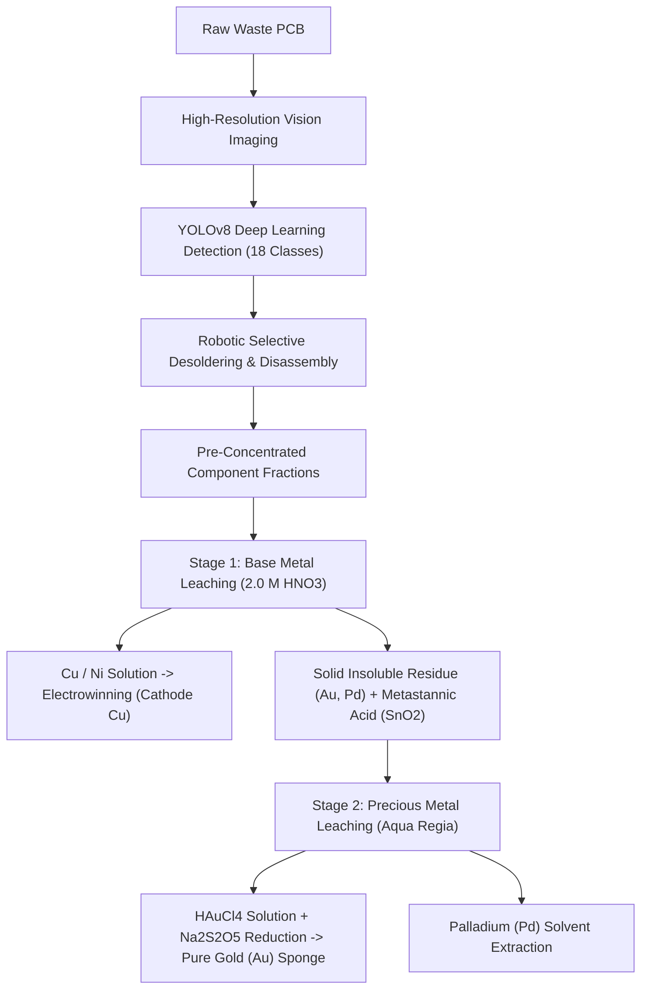

# ⚗️ Machine Vision-Assisted E-Waste Characterization & Real-Time Metallurgical Valuation Platform

[](https://share.streamlit.io)
[](https://www.python.org/)
[](https://ultralytics.com)
[-Metallurgical%20Engineering-800000.svg)](https://iitbhu.ac.in)

> **Department of Metallurgical Engineering, Indian Institute of Technology (Banaras Hindu University), Varanasi**  
> **Course:** MT-392 : Undergraduate Project / B.Tech Thesis  
> **Authors:** Sourav Kumar Agarwal (23145088), Rituraj Singh (23145065), Harman Singh Bhangu (23145034)  
> **Supervisor:** Dr. Kamalesh Kumar Singh | **Mentor:** Mr. Sayantan Mukherjee  

---

## 📌 Project Overview

Rapid miniaturization and dropping lifespans of modern consumer electronics have generated over **62 million metric tonnes of annual e-waste globally**. While waste printed circuit boards (WPCBs) represent high-grade secondary urban ores containing up to **200–500 g/t Gold** and **15–25% Copper**, conventional recycling relies on brute-force, whole-board shredding or hazard-prone informal smelting. Whole-board processing causes **30–40% precious metal loss** and consumes over **650 mL of concentrated nitric acid per board**.

This project establishes an **intelligent, non-destructive machine vision and hydrometallurgical valuation framework**:
1. **Fine-Tuned YOLOv8 Object Detection**: High-accuracy multi-class localization across 18 electronic component packages (ICs, ceramic MLCC capacitors, transformers, edge connectors, power transistors, etc.).
2. **Range-Based Metallurgical Assay Engine**: Calculates elemental mass inventories as realistic **Min – Expected – Max ranges** (e.g., Gold in ICs: 0.20 mg to 5.04 mg per unit).
3. **Live Commodity Spot Pricing**: Real-time integration with global commodity exchanges (COMEX/NYMEX) converting live precious/base metal prices into **Indian Rupees (₹)**.
4. **Stoichiometric Hydrometallurgical Cost & Net Profit Model**: Computes reagent requirements (68% $\text{HNO}_3$, Aqua Regia, $\text{Na}_2\text{S}_2\text{O}_5$) and delivers net profit per PCB board after subtracting chemical, energy, and labor costs.

---

## 🚀 Key Features

- **🏆 Real-Time Financial Valuation (₹ INR Only)**:
  - Gross Revenue Range (Min – Expected – Max)
  - Reagent & Extraction Cost Range
  - **Net Profit Range per Board** with profit margin percentages
- **🔍 Gold in IC Spotlight**: Isolates minimum and maximum gold yields and monetary returns from all detected integrated circuits.
- **⚡ Zero-Key Live Financial API**: Pulls live commodity futures (Au, Ag, Pd, Pt, Cu, Al) via free real-time feeds with automatic offline benchmark fallback.
- **🎯 Curated Highest-Confidence Benchmark Boards**: Pre-loaded test assemblies featuring verified $88\%$ to $97\%$ detection confidence scores.
- **🧪 Stoichiometric Acid Consumption Engine**: Demonstrates up to **79.8% reduction in nitric acid consumption** through vision-guided selective harvesting.

---

## 💻 Quick Start & Running Locally

### 1. Clone & Install Dependencies
```bash
git clone https://github.com/<YOUR_GITHUB_USERNAME>/pcb-metallurgy-valuation.git
cd pcb-metallurgy-valuation

# Create and activate virtual environment
python3 -m venv venv
source venv/bin/activate  # On Windows: venv\Scripts\activate

# Install required packages
pip install -r requirements.txt
```

### 2. Launch the Interactive Web Application
```bash
streamlit run app.py
```
Open **`http://localhost:8501`** in your browser.

### 3. Run Command-Line Detection
```bash
python3 detect.py --source dataset/test/images --max-images 1
```

---

## 📊 Industrial Hydrometallurgical Flowsheet



---

## 📦 Directory Structure

```text
pcb-metallurgy-valuation/
├── app.py                      # Interactive Streamlit Web Application
├── metallurgy_engine.py        # Metallurgical Assay, Live Pricing & Profit Engine
├── detect.py                   # Command-Line YOLOv8 Inference Script
├── run_demo.sh                 # One-click startup shell script
├── PCB_Testing_Demo.ipynb      # Interactive Jupyter / Colab Testing Notebook
├── requirements.txt            # Python dependencies (Streamlit, Ultralytics, PyTorch)
├── .gitignore                  # Git ignore rules
├── models/
│   └── pcb_best_model.pt       # Fine-tuned YOLOv8 weights (250 epochs, ~21 MB)
├── reports/
│   └── iit_bhu_logo.png        # Department & Institute branding
└── dataset/
    └── test/
        └── images/             # Benchmark test PCB assemblies
```

---

## 👥 Academic Attribution

**Department of Metallurgical Engineering, Indian Institute of Technology (BHU), Varanasi - 221005**  
- **Sourav Kumar Agarwal** (Roll No: 23145088)  
- **Rituraj Singh** (Roll No: 23145065)  
- **Harman Singh Bhangu** (Roll No: 23145034)  

**Supervisor:** Dr. Kamalesh Kumar Singh | **Mentor:** Mr. Sayantan Mukherjee  
